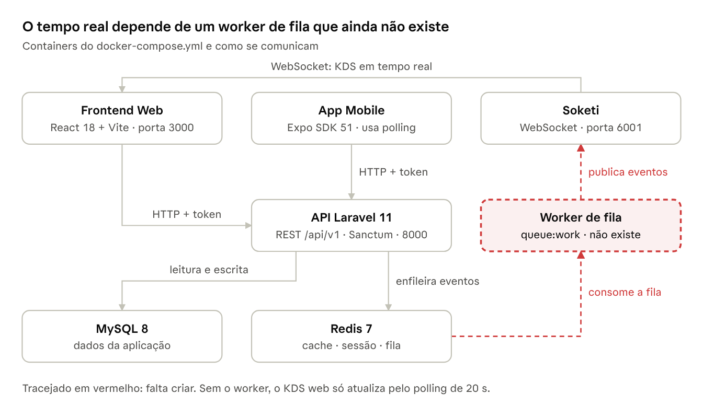

# Restaurante TxTech — O que falta para finalizar

16/11/2026 · Documento online: https://claude.ai/artifact/E4kzAkUaPXFuoxTVY2VbqL

## Resumo

O código cobre os 10 módulos previstos, mas o sistema ainda não roda de ponta a ponta. O [CHECKLIST.md](CHECKLIST.md) marca as 10 fases como concluídas, porém a análise do código encontrou 6 bloqueios que impedem o uso real:

1. **Falta a tabela `media`** (Spatie Media Library). Listar produtos e o cardápio falha; o próprio `laravel.log` registra o erro `Table 'restaurante_txtech.media' doesn't exist`.
2. **Não há worker de fila.** Os eventos `ShouldBroadcast` vão para a fila Redis, mas nenhum container roda `queue:work`. O KDS em tempo real nunca recebe eventos; só o polling de 20 s funciona.
3. **Editar produto com imagem não funciona.** O web envia `PUT` multipart, que o PHP não interpreta; campos e imagem chegam vazios.
4. **Dependências não instaladas.** `frontend/web/node_modules` está vazio e o mobile não tem `node_modules`; nenhum typecheck ou build foi verificado.
5. **Mobile sem assets.** `app.json` aponta para `icon.png`, `splash.png`, `adaptive-icon.png` e `favicon.png`, mas `assets/` só tem `.gitkeep`.
6. **Git bloqueado.** O repositório existe (10 commits, ligado ao GitHub), mas a pasta pertence a outro usuário do Windows e o Git se recusa a operar nela até ser liberada com `safe.directory`.

Além disso, faltam regras de negócio do pedido (transições de status, baixa de estoque, pagamento), testes automatizados (não existe `backend/tests/`) e toda a configuração de produção. O plano na última seção ordena isso em 6 fases.

## Arquitetura

Monorepo com API Laravel 11 (PHP 8.2, Sanctum, Spatie Permission e Media Library), web em React 18 + Vite + TypeScript + Tailwind + React Query + Zustand, e app Expo SDK 51 com expo-router.

Os eventos de pedido saem da API para a fila no Redis e só chegariam ao Soketi por um worker, que não está no `docker-compose.yml`. O app mobile não usa WebSocket: atualiza por polling de 10 a 30 s.

## Situação por módulo

Todos os módulos têm API e telas; o que falta está nas regras de negócio e em bugs pontuais. "—" na coluna Mobile indica que o módulo não existe no app (só no web).

| Módulo | Backend | Web | Mobile | O que falta |
| --- | --- | --- | --- | --- |
| Autenticação | Pronto | Pronto | Parcial | Mobile não espera o SecureStore carregar (`index.tsx` decide login antes da hidratação), não tem guarda de rota em `(app)/_layout.tsx` e o 401 não redireciona para o login. Login sem limite de tentativas. |
| Usuários | Parcial | Pronto | — | Busca usa `orWhere` sem agrupar, o que anula o filtro por papel. Gerente consegue excluir a si mesmo e o último gerente. |
| Categorias | Pronto | Pronto | — | Bloquear exclusão de categoria com produtos (hoje vira soft delete e os produtos continuam em `/produtos`). |
| Produtos | Quebrado | Parcial | — | Criar migration da tabela `media`. Trocar `PUT` multipart por `POST` + `_method=PUT`. Expor o estoque no `ProdutoResource`. |
| Mesas | Pronto | Parcial | Pronto | Web só guarda o `qr_code_token`: falta gerar e imprimir o QR Code. Mesa não é liberada quando o pedido é cancelado. |
| Pedidos | Parcial | Pronto | Pronto | Sem validação de transição de status (dá para ir de `entregue` para `aberto`). Aceita produto indisponível. Não permite adicionar itens a um pedido aberto. Item cancelado continua somando no total. `atualizarStatusItem` não confere se o item pertence ao pedido. Cancelar não emite evento. |
| KDS | Parcial | Parcial | Polling | Sem worker de fila, o Echo do web nunca recebe eventos. O pedido não muda sozinho para `em_preparo`/`pronto` conforme os itens. Canal `pedidos` é público. |
| Estoque | Parcial | Parcial | — | Nenhuma baixa automática na venda (`controla_estoque` não é usado). API pagina em 20 e o web lê só a 1ª página. Parâmetro `search` é ignorado pela API. |
| Caixa | Parcial | Pronto | — | Não há registro de pagamento nem forma de pagamento; `total_vendas` soma pedidos entregues pelo `updated_at`. Sem sangria/suprimento nem diferença esperado × informado no backend. |
| Relatórios | Parcial | Pronto | — | Datas usam `updated_at` do pedido, então qualquer edição posterior muda o dia da venda. Sem exportação (CSV/PDF). |
| Dashboard | Pronto | Pronto | Pronto | Herda a regra de data dos relatórios. |

Decidido em 17/11/2026: fechar a conta entra no escopo, junto com o autoatendimento por tablet na mesa (Fase 3 do plano). A tabela acima retrata a análise inicial.

## Pendências técnicas

O maior risco técnico é não haver nenhum teste: qualquer correção nas regras de pedido hoje é verificada só à mão.

**Testes e qualidade**

- Backend sem `tests/` nem `phpunit.xml`, embora PHPUnit 11 esteja no `composer.json`. Faltam factories (`database/factories/` só tem `.gitkeep`).
- Web tem script `lint`, mas nenhum arquivo de configuração do ESLint; nenhum teste de front.
- Typecheck do web e do mobile nunca foi rodado nesta cópia (sem `node_modules`).
- Mobile tem pastas vazias (`src/screens/cardapio`, `mesa`, `pedido`) e `LoginScreen` fora de `app/`: estrutura duplicada a limpar.
- Erro de digitação em `KdsPage.tsx` (`todosItensProon`) e `agora` congelado no primeiro render, então o tempo de espera do pedido não avança na tela.

**Segurança**

- CORS liberado para qualquer origem (`allowed_origins: ['*']`).
- `POST /auth/login` sem `throttle`; tokens Sanctum sem expiração.
- Eventos em canais públicos (`pedidos`, `pedido.{id}`): quem tiver a chave do Soketi escuta todos os pedidos. Usar `PrivateChannel` + `routes/channels.php` + rota de auth do broadcasting.
- Seeder cria 4 usuários com senha `senha123`; exigir troca ou não rodar o seeder em produção.
- `APP_DEBUG=true` no `.env` e no `docker-compose.yml`.

**Consistência de dados**

- Vendas datadas por `updated_at`: criar `entregue_em` (ou `pago_em`) e usar em caixa, dashboard e relatórios.
- Operações de status e estoque sem transação/lock: dois aparelhos podem mudar o mesmo pedido ao mesmo tempo.

## Infraestrutura e produção

O `docker-compose.yml` atual serve só para desenvolvimento; não existe nenhum caminho de deploy.

| Item | Hoje | O que fazer |
| --- | --- | --- |
| Worker de fila | Não existe | Serviço `queue` com `php artisan queue:work redis` (ou eventos `ShouldBroadcastNow` para dispensar a fila). |
| Agendador | Não existe | Serviço com `schedule:work`, necessário para limpar tokens expirados e jobs futuros. |
| Servidor PHP | `php artisan serve` | Imagem de produção com Nginx + PHP-FPM e `config:cache`/`route:cache`. |
| Web | Vite dev server na porta 3000 | `npm run build` e servir o `dist/` estático (Nginx ou CDN). |
| Build do backend | `composer install ... \|\| true` esconde falhas | Remover o `\|\| true` para o build falhar quando deve. |
| Imagens | `soketi:latest-16-alpine`, `mailpit:latest` | Fixar versões. |
| Uploads | Disco padrão do Media Library, `storage:link` manual | Definir disco público (ou S3) e incluir `storage:link` no entrypoint. |
| Mobile | Sem `eas.json`; API em `10.0.2.2` (só emulador Android) | Criar perfis EAS (dev/preview/production) e URL de API por ambiente. |
| CI | Nenhum | Pipeline com Pint, PHPUnit, `tsc` e `vite build` a cada push. |
| Operação | Nada | Backup do MySQL, HTTPS (WSS no Soketi), logs centralizados, `.env.production`. |

## Plano de finalização

A ordem segue a dependência: primeiro fazer rodar, depois corrigir regras, depois blindar e publicar. As Fases 1 e 2 são o mínimo para usar o sistema num restaurante de verdade.

**Fase 1 — Fazer rodar de ponta a ponta**

- [x] Repositório Git: já existia; estava só bloqueado por dono da pasta diferente
- [ ] Liberar o Git na máquina (`safe.directory`) e commitar as mudanças da Fase 1
- [x] Migration da tabela `media` criada e aplicada
- [x] Serviço `queue` no `docker-compose.yml`; cliente WebSocket recebeu `pedido.criado`
- [x] Update de produto com imagem (`POST` + `_method=PUT`), testado com upload real
- [x] `npm install` no web e no mobile; `tsc --noEmit` sem erros nos dois; `vite build` ok
- [x] Assets provisórios do mobile (trocar pela arte final)
- [x] Mobile: espera hidratação do SecureStore, guarda de rota e volta ao login no 401
- [x] Roteiro pela API: 4 papéis → pedido → KDS → entrega → caixa → relatórios, e 403 por papel
- [ ] Roteiro manual pelas telas do web e do app

**Fase 2 — Regras de negócio do pedido**

- [x] Máquina de estados do pedido: transição inválida dá 422, papel errado dá 403
- [x] Status do pedido derivado dos itens (primeiro em preparo → `em_preparo`; todos prontos → `pronto`)
- [x] Produto indisponível bloqueado; adicionar e remover itens em pedido aberto (API, web e app)
- [x] Item cancelado sai do total; item de outro pedido dá 404
- [x] Cancelamento libera a mesa, devolve o estoque e emite evento
- [x] Campo `entregue_em` usado em caixa, dashboard e relatórios
- [x] Baixa automática de estoque ao pedir, com bloqueio sem saldo e devolução no cancelamento
- [ ] Testar pelas telas do web e do app (29 verificações pela API já passaram)

**Fase 3 — Autoatendimento, conta da mesa e pagamento**

Decisões: tablet roda no navegador; cada mesa tem login e senha próprios (papel "mesa"); papel novo "bar"; fechamento com forma de pagamento, troco e taxa de serviço de 10% opcional.

- [x] Conta da mesa (comanda): junta todos os pedidos; a mesa só é liberada com o pagamento completo
- [x] Cozinha e bar: setor na categoria, KDS separado, cada setor só move os próprios itens
- [x] Tablet (`/mesa`): só cardápio, carrinho com os pedidos já feitos e "Solicitar conta"
- [x] Modo pagamento: divisão em N pessoas, taxa de 10% incluída com opção de tirar, cada parte paga por Pix, maquininha ou no caixa
- [x] Pix com camada de provedor e webhook; provedor simulado em desenvolvimento
- [x] Caixa: pagamentos parciais, confirmação da maquininha, troco, comprovante para imprimir
- [x] Salão: avisos de conta pedida, maquininha pedida e pedido pronto (web em tempo real, app por notificação)
- [x] Gerente liga ou desliga o tablet de cada mesa e define a senha na tela de Mesas
- [x] Receita de dashboard, caixa e relatórios vem dos pagamentos aprovados, com total por forma
- [ ] Escolher o provedor de Pix e implementar o driver real (conta empresarial, credenciais, webhook com HTTPS)
- [ ] Maquininha integrada (o valor vai direto para a máquina): depende da adquirente escolhida
- [ ] Aproximação no próprio tablet: só com app Android nativo e Tap to Pay da adquirente (adiado)
- [ ] NFC-e (nota fiscal): fora do escopo por ora; hoje sai comprovante sem valor fiscal
- [ ] Testar pelas telas (116 verificações de API passando)
- [ ] Sangria/suprimento e diferença esperado × informado no fechamento do caixa
- [ ] Arte final dos ícones e do tablet

**Fase 4 — Ajustes de telas**

- [ ] Gerar e imprimir QR Code das mesas no web
- [ ] Paginação ou listagem completa no Estoque; busca suportada pela API
- [ ] Corrigir busca de usuários e impedir autoexclusão / exclusão do último gerente
- [ ] Relógio do KDS atualizando; limpar estrutura duplicada do mobile
- [ ] Exportar relatórios em CSV/PDF

**Fase 5 — Segurança e testes**

- [ ] Canais privados no broadcasting + `routes/channels.php`
- [ ] CORS restrito aos domínios do web; `throttle` no login; expiração de tokens
- [ ] Factories + testes de feature: auth, permissões por papel, fluxo de pedido, caixa, estoque
- [ ] Config do ESLint no web e lint no mobile

**Fase 6 — Produção e entrega**

- [ ] Imagens de produção (Nginx + PHP-FPM, web estático) e `docker-compose.prod.yml`
- [ ] CI com Pint, PHPUnit, `tsc` e build
- [ ] HTTPS/WSS, backups do MySQL, `.env.production` sem debug e sem senhas padrão
- [ ] Builds EAS do mobile (APK interno ou lojas)
- [ ] Atualizar README e `CHECKLIST.md` para refletir o estado real
